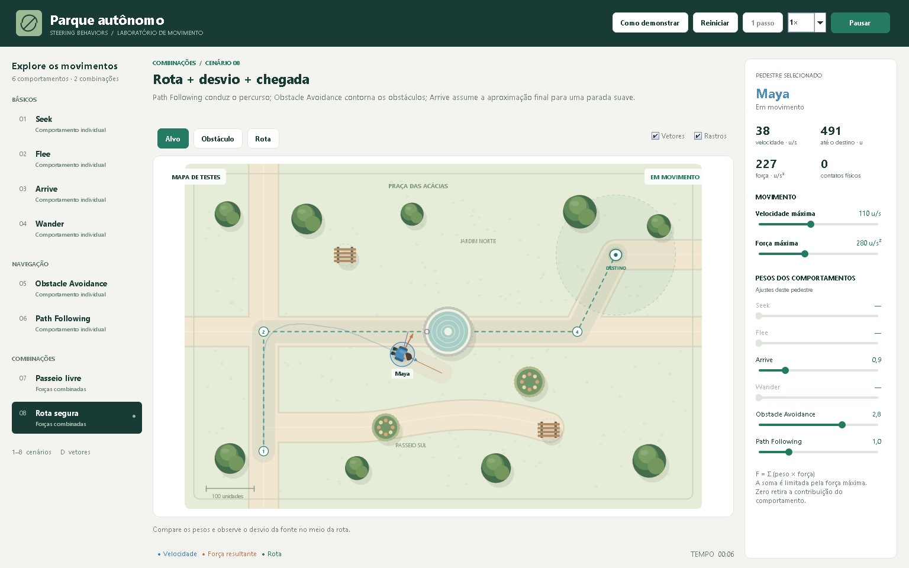

# Parque autônomo — Somativa 2 / Steering Behavior

Aplicação **Java puro**, com **Swing + Java2D** e organização **MVC**, para demonstrar agentes humanos com Steering Behaviors em uma praça 2D. Interface, desenho dos personagens e código da simulação foram desenvolvidos para este projeto; o template SBCarsEngine foi consultado como referência, sem incorporar seu código.



## Executar

**Requisito:** JDK **17 ou superior**. Não é necessário Maven, Gradle, JavaFX ou bibliotecas externas.

### Windows

Dê dois cliques em **`Executar.cmd`** na raiz do projeto. O comando compila e abre a aplicação.

O script procura um JDK em `JAVA_HOME`, na pasta `.jdks` do usuário, nas instalações de fornecedores e no `PATH`. Ele ignora instalações antigas incompatíveis. Um JRE 8 sozinho não atende ao requisito.

Para apenas compilar:

```powershell
powershell -NoProfile -ExecutionPolicy Bypass -File scripts/build.ps1
```

O JAR executável é gerado em `dist/ParqueAutonomo.jar`. Com Java 17+ disponível no terminal:

```text
java -jar dist/ParqueAutonomo.jar
```

### Linux / macOS

Com `java`, `javac` e `jar` do JDK 17+ no `PATH`:

```sh
sh run.sh
```

A classe principal é `br.edu.steering.App`. Também é possível abrir `src/main/java` em uma IDE, configurar o JDK 17+ e executar essa classe.

## Como usar a interface

- Selecione um dos **oito cenários** na lateral esquerda, ou use as teclas **1 a 8**. Cada seleção recria o mapa e o agente com os parâmetros iniciais.
- Na ferramenta **Alvo**, clique no mapa para mudar o destino ou a ameaça. Wander e Passeio livre escolhem seu próprio alvo de movimentação.
- Em **Obstáculo**, clique em uma área livre para adicionar um canteiro. **Botão direito** remove um obstáculo, independentemente da ferramenta.
- Em **Rota**, clique para criar um percurso com pelo menos dois pontos. A simulação pausa durante a edição; use **Continuar** para testar. Selecionar Rota novamente começa outro desenho. Se o cenário atual não acompanha caminhos, a ferramenta abre Rota segura.
- Ajuste **velocidade máxima, força máxima e pesos** na lateral direita. Peso zero retira a contribuição do comportamento. Controles desabilitados correspondem a comportamentos que não participam do cenário atual.
- Ative **Vetores** para observar velocidade em azul, força resultante em laranja e informações do sensor/projeção. Ative **Rastros** para acompanhar a trajetória.
- Use **Pausar**, **1 passo**, **Reiniciar** e a taxa de tempo **0,5× / 1× / 2×**. O botão **Como demonstrar** abre um guia dentro da aplicação.

| Atalho | Ação |
| --- | --- |
| Espaço | Pausar / continuar |
| R | Reiniciar o cenário |
| D | Alternar vetores |
| N | Avançar 1/60 s durante a pausa |
| 1–8 | Selecionar cenário |

## Atendimento ao enunciado

| Requisito | Implementação |
| --- | --- |
| Quatro comportamentos simples | Seek, Flee, Arrive e Wander |
| Dois comportamentos avançados | Obstacle Avoidance e Path Following |
| Mapa de testes | Praça com árvores, bancos, canteiros, fonte e caminhos |
| Pelo menos duas combinações | Passeio livre e Rota segura |
| Ajuste e justificativa dos pesos | Sliders na interface e explicações abaixo |
| Código-fonte e README | Neste repositório público |
| Demonstração dos testes | Oito cenários interativos e guia de apresentação |

O enunciado prático, página 1, seção 2, permite: **“As combinações podem ser feitas a partir de input em um único agente, ou implementar dois agentes com combinações distintas.”** Este projeto usa a primeira opção: seleção por input na interface. Os seis comportamentos permanecem disponíveis individualmente e as duas combinações têm configurações próprias. A escolha de cenários não elimina nenhum comportamento obrigatório.

Trabalho **individual**, conforme acordo com a professora informado pelo estudante. Entrega **prática**, com código e demonstração pela interface; o trabalho teórico e o ponto extra estão fora do escopo. A defesa é obrigatória.

## Modelo de movimento

A posição, a velocidade e as forças usam vetores 2D imutáveis. O agente tem massa unitária, velocidade máxima e força máxima. Para uma velocidade desejada `v_d`, usa-se um tempo de resposta `τ = 0,45 s`:

```text
força do comportamento = limitar((v_d - velocidade) × massa / τ, força máxima)
força total = limitar(Σ(peso_i × força_i) + contenção de borda, força máxima)
aceleração = força total / massa
velocidade = limitar(velocidade + aceleração × dt, velocidade máxima)
posição = posição + velocidade × dt
```

A integração é Euler semi-implícita. O Controller mede o tempo com `System.nanoTime`; o Model divide a atualização em subpassos de no máximo **1/120 s**. A contenção suave das bordas mantém o pedestre visível e é um recurso auxiliar do mapa.

### Seek — cenário 1 / Lia

Calcula a direção do agente até o alvo e deseja mover-se nessa direção à velocidade máxima. A força corrige a velocidade atual gradualmente. **Não inclui desaceleração planejada:** pode ultrapassar o alvo e voltar a buscá-lo. Essa diferença é observável ao comparar com Arrive.

### Flee — cenário 2 / Caio

Deseja mover-se na direção oposta à ameaça quando ela está dentro do raio de percepção de **190 unidades**. Fora desse raio, a velocidade desejada é zero e o agente freia. Se agente e ameaça coincidirem, a orientação atual fornece uma direção válida de fuga.

### Arrive — cenário 3 / Nina

Reduz a velocidade desejada proporcionalmente à distância quando o destino está a menos de **125 unidades**. A menos de **3 unidades**, a velocidade desejada passa a zero. Isso produz aproximação e parada suaves, sem teletransportar o agente para o alvo.

### Wander — cenário 4 / Davi

Mantém um círculo de raio **38** a **65 unidades** à frente do agente. Um ângulo persistente recebe pequenas perturbações aleatórias proporcionais a `√dt`; o ponto no círculo se torna o alvo local. A memória do ângulo gera mudanças contínuas de direção. Cada agente usa uma semente fixa, restaurada ao reiniciar, para facilitar a comparação dos parâmetros.

### Obstacle Avoidance — cenário 5 / Bia

O cenário usa **Seek (0,8)** como intenção de movimento e **Obstacle Avoidance (2,6)** para atravessar a praça sem bater na fonte.

O sensor olha à frente por `55 + 0,95 × velocidade`. Para considerar o volume do pedestre, cada obstáculo circular é expandido por **raio do agente + 18 unidades de margem**. A projeção longitudinal/lateral identifica o primeiro obstáculo interceptado pelo corredor do sensor. A resposta soma força lateral e frenagem conforme a proximidade. O lado de desvio fica associado ao obstáculo para reduzir oscilações.

O desvio é antecipatório. Uma correção de penetração existe como salvaguarda física e incrementa o contador **contatos físicos**; ela não é contabilizada como sucesso do comportamento. Para comparar, reinicie, zere o peso do desvio e observe o contato com a fonte.

### Path Following — cenário 6 / Ivo

A rota é uma polilinha aberta. O comportamento projeta a posição atual e uma posição prevista nos segmentos, mantém o progresso acumulado e busca um ponto adiante. O ponto de antecipação varia com a velocidade. Perto do fim, usa a mesma política de desaceleração de Arrive para encerrar o caminho.

É **seguimento de caminho**, não busca de caminho: os pontos são definidos no mapa ou desenhados pelo usuário; não há A* ou planejamento global de trajetórias.

## Combinações e pesos

### Passeio livre — cenário 7 / Theo

```text
Wander × 0,9 + Obstacle Avoidance × 2,6
```

Wander sustenta o passeio sem um destino fixo. O peso maior do desvio permite que a prevenção de obstáculos se sobreponha à exploração quando o sensor detecta risco. A velocidade máxima inicial de **92 unidades/s** dá tempo para o agente antecipar curvas. O agente continua explorando depois de contornar um obstáculo.

### Rota segura — cenário 8 / Maya

```text
Path Following × 1,0 + Obstacle Avoidance × 2,8 + Arrive × 0,9
```

Path Following conduz o percurso; Obstacle Avoidance recebe peso maior para contornar a fonte, mesmo quando a rota passa pelo seu centro. Após o desvio, o agente volta a acompanhar os segmentos. Nos últimos **150** de distância acumulada da rota, a contribuição de acompanhamento diminui progressivamente e a de Arrive passa a atuar no destino final.

Arrive fica inativo antes da região final, evitando que atraia o agente diretamente ao destino e corte o percurso. A força resultante é limitada, impedindo acelerações arbitrárias quando vários comportamentos atuam juntos.

Os valores iniciais foram verificados com o mapa fornecido. Alterações extremas de pesos ou novos obstáculos podem produzir contatos ou trajetórias pouco eficientes; a interface permite observar e justificar esses efeitos. Não há separação entre pedestres nem procura global por saídas de labirintos: o foco são os seis comportamentos solicitados, com obstáculos estáticos circulares.

## Organização MVC

```text
src/main/java/br/edu/steering/
  App.java                       entrada e conexão das partes
  model/
    Agent.java                   estado, parâmetros e integração do pedestre
    AgentProfile.java            configurações textuais dos oito cenários
    World.java                   mapa, criação dos cenários e atualização
    Obstacle.java / Route.java   geometria dos obstáculos e caminhos
    math/Vec2.java               operações vetoriais
    behavior/                    seis comportamentos e combinação ponderada
  view/
    MainView.java                janela, controles e informações
    MapPanel.java                desenho da praça e dos personagens
    Theme.java / PillButton.java identidade visual
  controller/
    SimulationController.java   eventos, comandos e ciclo de atualização
src/test/java/br/edu/steering/
  Verification.java              verificações de resultados e integração
```

O **Model não importa Swing ou AWT**. A View desenha e expõe eventos; o Controller altera o Model e solicita o redesenho. Eventos, atualização e desenho são coordenados pela thread de eventos do Swing, evitando concorrência entre leitura e escrita do estado.

Mais detalhes: [arquitetura](docs/arquitetura.md), [requisitos](docs/requisitos.md) e [roteiro de demonstração](docs/roteiro-demonstracao.md).

## Verificação do projeto

Os testes da apresentação são realizados na própria interface. Para conferir também os resultados numéricos e a integração dos controles durante o desenvolvimento, existe uma verificação opcional em Java puro:

```text
Verificar.cmd
```

Ela compila o projeto, verifica os comportamentos, compara o desvio com peso ativo e zerado, confirma conclusão de rotas, limites físicos, pausa, sliders e edição de obstáculos/rotas. Também renderiza a interface em **1536×960** e **1180×760**. O relatório e as imagens ficam em `output/`. Nenhum framework de testes é necessário. A última execução concluiu **26 verificações, sem falhas**; consulte o [relatório](docs/verificacao.txt).

## Referência conceitual

Craig W. Reynolds, [Steering Behaviors For Autonomous Characters](https://www.red3d.com/cwr/steer/gdc99/), GDC 1999. A implementação adota um modelo simplificado de locomoção e combina forças de steering para demonstrar os conceitos na interface.
